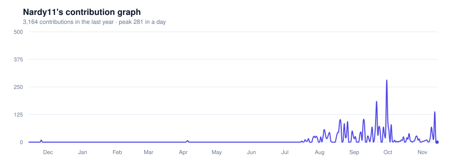

# Hi, I'm Nardy 👋

### Machine Learning Engineer · Computer Vision · NLP · Generative AI

I build ML systems that leave the notebook: models with safety checks, real-time perception,
and language features, served inside products people actually use.

**Full Stack Engineer at Poseidon IT** · Computer Engineering graduate · Cairo, Egypt

**🟢 Open to freelance ML work**

  

 

---

## 🧠 What I build

| 👁️ Computer vision | 💬 NLP & LLMs | 🎨 Generative AI | ⚙️ ML engineering |
|---|---|---|---|
| Detection & tracking (YOLO, OpenVINO) | RAG with citations, Arabic + English | Diffusion image editing (FLUX.2) | FastAPI model serving |
| Segmentation & pose (SegFormer, MediaPipe) | Text classification & clustering | Safety & content checks | Docker, CI, tests |
| Body measurement from photos | LLM features (Gemini) | Self-hosted, GPU-efficient inference | Deploying ML inside real products |

## 🚀 Featured ML projects

### 🪞 [Velvet Mirror](https://github.com/Nardy11/velvet-mirror) · [▶ live](https://nardy11.github.io/velvet-mirror/)
**Generative AI + computer vision.** Virtual try-on that runs on a laptop GPU. FLUX.2 Klein redraws only
the clothes, guided by clothes parsing and pose estimation. It estimates your size from a photo and your
height, then draws how a size you can buy would really fit. Every photo and result passes three
independent safety checks. About 15–25 s per look on an RTX 4060.

`PyTorch` `Diffusers` `SegFormer` `MediaPipe` `CLIP` `OpenCV` `FastAPI` `React`

### 🚗 [CPAC Autonomous Perception](https://github.com/Nardy11/cpac-autonomous-perception) · [▶ live](https://nardy11.github.io/cpac-autonomous-perception/)
**Real-time perception for connected vehicles** (graduation project). Custom-trained YOLOv8n
(mAP@0.5 0.67), OpenVINO optimisation (39 FPS on CPU vs 30 with PyTorch), centroid and Kalman tracking,
monocular distance estimation, lane detection and ROS nodes. The live demo runs detection in your browser.

`YOLOv8` `OpenVINO` `ONNX` `OpenCV` `Kalman filter` `ROS`

### 💬 [Bilingual RAG Assistant](https://github.com/Nardy11/bilingual-rag-assistant) · [▶ live](https://nardy11.github.io/bilingual-rag-assistant/)
**LLM / RAG, Arabic + English.** Answers questions about your documents with citations, across
languages. Hybrid search (BM25 + multilingual embeddings) with re-ranking reaches Recall@5 1.00 and
MRR 0.967 on a 30-question bilingual test set. Works with Gemini, any OpenAI-compatible model, or no key.

`RAG` `multilingual-e5` `FAISS` `BM25` `cross-encoder` `FastAPI` `transformers.js`

### 📄 [AI Resume Matcher](https://github.com/Nardy11/ai-resume-matcher) · [▶ live](https://nardy11.github.io/ai-resume-matcher/)
**NLP.** Scores a CV against a job description with SBERT and TF-IDF, lists matched and missing
skills, and flags biased wording. ROC AUC 1.00 and 95% accuracy on 20 labelled pairs; 22 tests, CI.

`SBERT` `scikit-learn` `FastAPI` `pytest` `Docker` `GitHub Actions`

### 💳 [Transaction Classifier MLOps](https://github.com/Nardy11/transaction-classifier-mlops) · [▶ live](https://nardy11.github.io/transaction-classifier-mlops/)
**MLOps.** Categorises retail transactions (TF-IDF → SVD → clustering → classifier), packaged with
MLflow tracking, a FastAPI service, drift checks and CI that trains and tests. 97.1% accuracy on
descriptions the model never saw, with an honest note on what pseudo-labels can and can't prove.

`scikit-learn` `MLflow` `FastAPI` `Docker` `GitHub Actions`

### 🩺 [Heart Failure Prediction](https://github.com/Nardy11/Heart_Failure_prediction) · [▶ live](https://nardy11.github.io/Heart_Failure_prediction/)
**Explainable classical ML.** Seven models compared; the deployed logistic regression reaches 91.3%
accuracy and AUC 0.935 on a held-out set, explains each prediction, and ships with a model card.

`pandas` `scikit-learn` `PCA` `model card`

### 🗣️ [LanguageLab](https://github.com/Nardy11/LanguageLab) · [▶ live](https://languages-lab.vercel.app)
**LLM product.** A CEFR language-learning platform where Gemini checks learners' answers and explains
mistakes, with a local fallback when the model is unavailable.

`Gemini` `Next.js` `React`

### 🖐️ [AI Interactive Portfolio](https://github.com/Nardy11/AI-Interactive-Portfolio) · [▶ live](https://ai-interactive-portfolio.vercel.app/)
A portfolio you can browse with hand gestures (MediaPipe hand landmarks in the browser) or by asking
an assistant.

`MediaPipe` `TensorFlow.js` `Next.js` `FastAPI`

## 🛠️ I also ship full products

At **Poseidon IT** I work as a full-stack engineer on web, mobile and API work. That is why my models
come with a product around them. Some examples:

- 🏥 [Virtual clinic](https://github.com/Nardy11/Aplus-Cant-Lose-Clinic) · [▶ live demo](https://nardy11.github.io/Aplus-Cant-Lose-Clinic/): video visits, payments and prescriptions (React, Express, MongoDB)
- 📊 [Arabic sales operations](https://github.com/Nardy11/sales-mongaz-prototype): an RTL-first workspace for field sales teams (React, TypeScript, PostgreSQL)
- 📱 [Climate Edge](https://github.com/Nardy11/Climate-Edge-Company-Flutter-app-web): a Flutter + Firebase document workflow app

## 🤝 Work with me

I take freelance projects such as:
- **Object detection & tracking** for retail, security or traffic video
- **RAG chatbots** over your documents, in Arabic and English
- **Document & CV matching**, semantic search, text classification
- **Virtual try-on and image editing** with self-hosted generative models
- **Notebook → production**: turning a model into a tested, deployed API

📧 [nardymichelle2003@gmail.com](mailto:nardymichelle2003@gmail.com) · 💼 [LinkedIn](https://www.linkedin.com/in/nardy-attallah)

## 📊 GitHub activity

<a href="https://nardy11.github.io/Nardy11/">
  <picture>
    <source media="(prefers-color-scheme: dark)" srcset="https://raw.githubusercontent.com/Nardy11/Nardy11/output/activity-graph-dark.svg">
    <source media="(prefers-color-scheme: light)" srcset="https://raw.githubusercontent.com/Nardy11/Nardy11/output/activity-graph.svg">
    
  </picture>
</a>

📈 <a href="https://nardy11.github.io/Nardy11/">Open the interactive version</a> to hover any day for its exact contribution count.

<picture>
  <source media="(prefers-color-scheme: dark)" srcset="https://raw.githubusercontent.com/Nardy11/Nardy11/output/github-contribution-grid-snake-dark.svg">
  <source media="(prefers-color-scheme: light)" srcset="https://raw.githubusercontent.com/Nardy11/Nardy11/output/github-contribution-grid-snake.svg">
  
</picture>

## 💼 Background

- **Now:** Full Stack Engineer at **Poseidon IT**: frontend, mobile, backend, APIs and databases.
- **Before:** computer vision, machine learning, data analysis, Flutter development and technical operations.
- **Graduation project:** [cooperative perception for connected vehicles](https://github.com/Nardy11/cpac-autonomous-perception) (YOLO, OpenVINO, lane detection, Kalman tracking, ROS).
